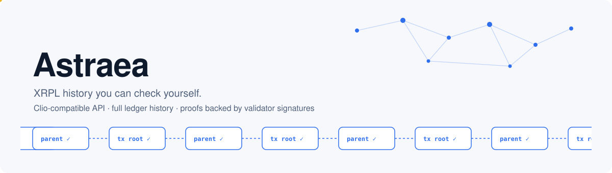
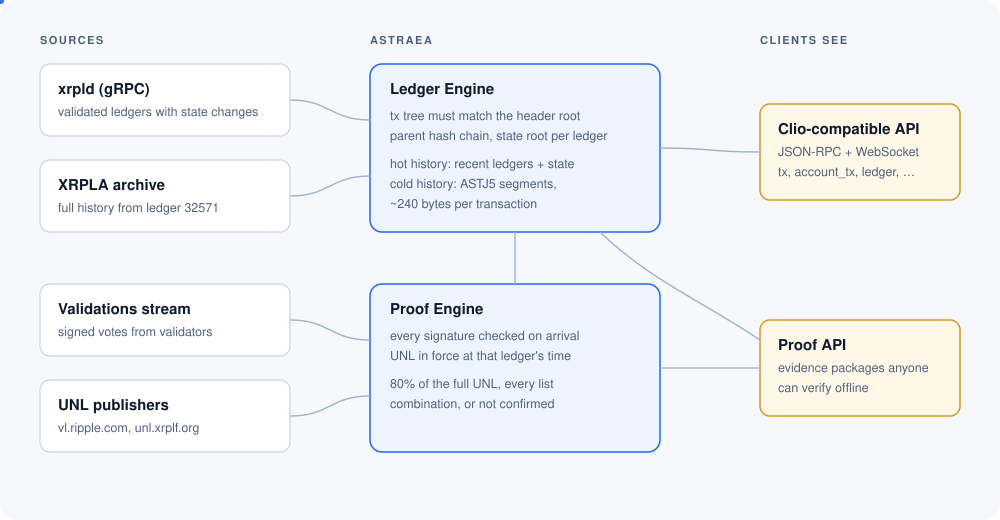

<p align="center">
  
</p>

Astraea is a history server for the XRP Ledger. It speaks the same JSON-RPC and WebSocket API as [Clio](https://github.com/XRPLF/clio), so an existing client can point at it without changes. It stores the whole public history, back to ledger 32571, in a compact format of its own. It can also hand you a package of evidence for any ledger, transaction or state object, which you can check on your own machine without trusting Astraea or any node.

Version 0.5 is the first stable release. Astraea answers everything Clio answers, over the full history.

## Public endpoint

A public endpoint run by the maintainers is coming soon, and its address will be published here. Until then, you can run a server of your own: see [docs/running.md](docs/running.md).

## Why another history server

A Clio or rippled node answers questions about the ledger, and you take its word for it. That is usually enough, but not when the answer matters to someone who doesn't run the node, like an auditor or a lender checking that a repayment really landed.

Astraea gives the same answers and also keeps the evidence for them. Every ledger it stores has passed three checks before it is written:

- the transaction tree rebuilt from the stored transactions matches the root in the ledger header;
- the header's parent hash matches the previous ledger;
- validators from the UNL that was in force at the time signed that ledger, with at least 80% of the full list agreeing.

The signatures and the UNL lists are archived next to the data, byte for byte as the network and the list publishers sent them. From them Astraea can build a proof for an old ledger as well as for the newest one.

## How it fits together

<p align="center">
  
</p>

The **Ledger Engine** loads validated ledgers from xrpld over gRPC, the same way Clio does. Recent ledgers live in a hot store together with the full account state at every ledger. Older history is packed into cold ASTJ6 segments. With all of its indexes (transaction by hash, ledger by hash, account history) the whole mainnet history takes about 208 bytes per transaction on disk.

The **Proof Engine** listens to the validations stream, checks each signature as it arrives, and decides whether a ledger reached quorum using the UNL lists that were valid for that ledger's close time. It doesn't take the node's word for "validated".

Both feed the API. More detail in [docs/architecture.md](docs/architecture.md).

## How it differs from Clio

Clio keeps history in a database server. Astraea keeps it in files, in a codec built for XRPL's binary objects, read by the server itself. On the same ledgers on one host, history takes about a third of the disk Clio needs, and no database runs next to it. Clio is still slightly faster on deep pages of old history, because Astraea has to decode blocks to read them. The method, the numbers and the cases where Clio is ahead are in [docs/compared-with-clio.md](docs/compared-with-clio.md).

## What you can ask it

Clio-compatible methods, answered from Astraea's own data:

`server_info`, `ping`, `ledger`, `tx` (by hash or CTID), `account_tx`, `account_info`, `account_lines`, `account_objects`, `account_offers`, `ledger_entry`, `ledger_data`, `mpt_holders`, `account_nfts`, `nft_buy_offers`, `nft_sell_offers`, `nft_info`, `nft_history`, `nfts_by_issuer`, `book_changes`, and WebSocket `subscribe` for the `ledger`, `transactions`, `book_changes`, `validations` and `manifests` streams and for accounts.

Methods that Clio forwards to a node (`fee`, `server_state`, `ledger_current`, `server_definitions`, and read-only queries against the open ledger) are forwarded the same way. `submit` and `simulate` can be forwarded for your own services with `--forward-submissions`: they are off by default, never available on a public listener, and Astraea never signs on a client's behalf.

`GET /health` answers 200 while the latest ledger is at most 60 seconds old, for a load balancer or a monitor.

Proof methods: `proof_ledger`, `proof_tx` and `proof_entry` return an evidence package. The package format is described in [docs/evidence-format.md](docs/evidence-format.md), and `witness-verify evidence` checks one offline. `proof_ledger` and `proof_tx` cover all of history: an old ledger is reached through the skip lists the network keeps in its own state, which hold the hash of every 256th ledger since the start. `proof_entry` proves an object, or its absence, in the latest state or at any earlier ledger the server has state for.

See [docs/api.md](docs/api.md) for parameters, differences from Clio and error behaviour.

## What a proof shows

<p align="center">
  
</p>

A package for a transaction carries the validations that put an anchor ledger over quorum, the UNL lists and manifests that say who was allowed to vote, the chain of headers from the target ledger up to the anchor, and the path of sibling hashes from the transaction to the tree root in the target header. Each step is plain hashing and signature checks. The package also says what it does not prove; for example, it can show a transaction is in the ledger, but not that an account's history is complete.

## Repository layout

| Crate | What it is |
|---|---|
| `crates/ledger-engine` | Loader, hot and cold history, indexes, the API server (`astraea-ingest`), maintenance tools (`astraea-state`, `astraea-xrpla`) |
| `crates/astj5` | ASTJ, the cold-history codec: segment format and block pool |
| `crates/witness-core` | XRPL primitives with no I/O: hashing, STObject parsing, keys and signatures, manifests, UNL lists, SHAMap proofs, quorum rules, evidence packages |
| `crates/witness-archiver` | Archives raw signed validations from a node into sealed segments |
| `crates/witness-unl` | Polls UNL publishers and keeps every signed list it has seen |
| `crates/witness-store` | Append-only segment store with a hash chain of seals |
| `crates/witness-verify` | Independent checker for the archive and for evidence packages |

`scripts/` has the tools used to load the full history and to compare Astraea with Clio request by request. `tools/readme-art.py` draws the animated graphics in `assets/`.

## Building

Rust 1.99.1 is pinned in `rust-toolchain.toml`. Protobuf definitions are compiled in-process, so you don't need `protoc`.

```bash
cargo build --release
```

```bash
cargo test --workspace
```

Running a node of your own is covered in [docs/running.md](docs/running.md). The short version: point `astraea-ingest` at an xrpld gRPC port and at one or more validation streams, give it a data directory and an API address, and it starts filling history from the moment it connects. Older history comes from the XRPLA archive with `astraea-xrpla` and `astraea-state history-cold`.

## Status and plans

Version 0.1 covered what a Clio replacement needs plus proofs; 0.2 extended proofs to all of history; 0.3 completed Clio's surface and added what a public server needs; 0.4 made the history smaller and removed research code that was never part of the server; 0.5 added separate listeners for public clients and is the first stable release. What comes next is in [ROADMAP.md](ROADMAP.md).

### Full history

The whole public history is loaded, from ledger 32571 (1 January 2013) to the current ledger. The archive was loaded from the newest ledger down, in chunks of 32768 ledgers; each chunk was checked and written as cold segments, and groups of chunks got their indexes and became visible in the API without a restart. The load finished on 30 October 2026.

On disk, the 5.18 billion transactions of the cold history take 1.08 TB: 1.03 TB of cold segments, about 199 bytes per transaction, and 44 GB of indexes, about 9 bytes per transaction. That is 208 bytes per transaction in total, measured in November 2026 after the whole history was rewritten in the `astraea-cold/2` format. The load itself ended at 251 bytes per transaction. The cost of the segments depends on the era: about 158 bytes per transaction for ledgers 30 to 60 million, 229 for ledgers 60 to 85 million, and 205 from ledger 85 million on.

## License

ISC: see [LICENSE.md](LICENSE.md). The gRPC definitions in `crates/ledger-engine/proto` come from xrpld and keep its license.

## Security and contributing

Send vulnerabilities privately to **dev@xrpl-lending.network**, never to an issue or a pull request: see [SECURITY.md](SECURITY.md). Improvements are welcome as pull requests: see [CONTRIBUTING.md](CONTRIBUTING.md).
