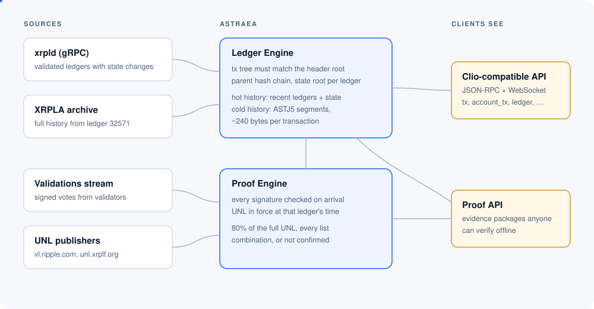

# Architecture

Astraea has two halves that grew from one rule: never store or serve something you can't check.

The Ledger Engine decides what the ledgers *contain*. The Proof Engine decides whether the network actually *agreed* on them. A ledger shows up in the API only when both are satisfied.

## Ledger Engine

`astraea-ingest` pulls validated ledgers from one xrpld node over gRPC (`GetLedger` with transactions and state changes, the same call Clio uses). The node is a convenient source, not an authority. Before anything is written:

- the transaction tree is rebuilt from the transactions and metadata, and its root must equal `transaction_hash` in the header;
- the header hash is recomputed, and the header's `parent_hash` must equal the hash of the ledger before it;
- the account-state tree is updated with the ledger's changes, and its root must equal `account_hash` in the header.

A ledger that fails any of these is rejected and the loader retries it. A node that lies can stall Astraea, but it can't put wrong data into it.

### Hot store

Recent history and state live in the hot store under `<data-dir>`:

- **state**: a snapshot of every ledger object plus every later version of each object, in a [fjall](https://github.com/fjall-rs/fjall) LSM tree. Any object can be read at any ledger since the snapshot. This is what `account_info`, `account_lines`, `account_objects`, `ledger_entry`, `ledger_data`, `mpt_holders`, `account_nfts` and the NFT offer methods use. Next to the object versions it keeps the NFT index, Clio's four NFT tables: a token's owner and its URI at each ledger they changed, the tokens of each issuer by taxon, and each token's transactions. New ledgers are indexed in the same batch as their state; a store that adds the index fills earlier ledgers in the background, from the history, and keeps its progress, so a restart continues where it stopped. The same store keeps the state tree (SHAMap) of the latest ledger and its history: for each ledger, the hashes of the subtrees at depth 3 (4096 of them) that it changed, and all of them every 256 ledgers. A path at an earlier ledger takes the top of the tree from there and rebuilds the key's subtree, about 1700 objects on mainnet, from the object versions; the root has to match the ledger's `AccountHash`. A store that started keeping the history after its snapshot rebuilds the missing part at startup, in the background. The object versions of one subtree are one key range, so each subtree is replayed on its own in memory, on several threads, and a second pass puts the top of the tree together for every ledger and checks it against `AccountHash`. On mainnet this takes under two minutes per 50 thousand ledgers. After a stop, subtrees already replayed are not read again.
- **history**: segments with one zstd frame of transactions per ledger, plus state-change blocks kept for rebuilds. Indexes map transaction hash to position, ledger hash to sequence, and account to its transactions.

### Cold store

Ledgers older than the state snapshot have transactions but no queryable state. They live in cold segments written in the ASTJ6 format (`crates/astj5`), which is ASTJ5 with its blocks cut into parts; older ASTJ5 segments are read as before. A segment with first ledger `F` is four files, plus an optional seal:

| File | Contents |
|---|---|
| `cold-F.astj` | independent blocks of up to 1024 ledgers or 4 MiB, each with a SHA-512Half of its exact bytes; an ASTJ6 block is cut into parts of up to 1 MiB |
| `cold-F.asix` | ASIX2 indexes built by the codec |
| `cold-F.kinds` | kind of each state change, when the source recorded it |
| `cold-F.seal` | digests of each block's stored bytes (of an ASTJ6 block, its head and every part), recorded after the block passed the full check |
| `cold-F.json` | manifest: range, profile, sizes and hashes of the other files; written last |

Every block gets a full check: its hash, the transaction roots of its ledgers and the header chain. The check costs about as much as decoding the block, so it runs once, when the segment is written, and the seal records it. When a block is loaded for reading, the server hashes its stored bytes and compares them with the seal. If they match, the block is decoded without repeating the check. If they don't, or the segment has no seal, the block is checked in full again. A damaged block becomes an error, never a wrong answer. Segments written before seals existed can be sealed with `astraea-state history-cold-seal DIR`.

An ASTJ5 block decodes only as a whole, so a page of `account_tx` that finds one transaction in each of 200 blocks decodes 200 blocks of 4 MiB, about 7 ms each. An ASTJ6 block keeps the codec's dictionary and templates in a shared section and cuts the ledgers into parts of up to 1 MiB of exact bytes. Each part has its own columns, its own dictionary for the values no other part uses, and its own zstd frame compressed against the shared section. Repeats and transaction hashes derived from other transactions don't reach outside a part. Reading one transaction then decodes the shared section and one part, about 2 ms on recent history, and only those bytes are hashed against the seal. Parts cost 8% in size on recent history and 17% around ledger 98 million. `astraea-state history-cold-recode DIR` rewrites ASTJ5 segments as ASTJ6 in place while the server runs.

Cold segments are grouped into index partitions (`coldidx-F.*`) for transaction-by-hash, account history and ledger-by-hash lookups. These are read straight from disk with positioned reads, so memory use doesn't grow with history.

On the 1.8 billion transactions loaded by October 2026 the cold store takes 259 bytes per transaction with all indexes: about 232 for the segments and 27 for the index partitions.

### Publishing history without a restart

The server re-reads the history directory in the background. A new cold group becomes visible in a fixed order: data files, segment manifests, index files, and the index manifest last. The API extends its range downward only through index manifests, and it reads index manifests before segments, so the advertised range never runs ahead of the data. `scripts/astraea-full-publish.py` follows this order when it publishes groups loaded from the archive.

### Full history from the XRPLA archive

A node can't serve ledgers it never had, so the deep past comes from the [XRPLA](https://xrpla-data.firstledger.net) publication. `astraea-xrpla fetch` downloads a range and checks it: the catalog signature (Ed25519, the key is pinned in the binary), digests of every directory and segment, transaction-tree roots against headers, and an unbroken parent-hash chain over the whole requested range. Then `astraea-state history-cold` writes cold segments, decoding every ledger back and comparing it with the input before keeping it, and `astraea-state history-cold-index` builds the indexes, checking the header chain again.

The archive doesn't carry state trees, so state changes in these segments aren't verified against `account_hash`. Nothing in the API serves them; only transactions and headers are used.

## Proof Engine

The Proof Engine answers one question: did the network validate this ledger?

- `witness-unl` polls the UNL publishers (by default vl.ripple.com and unl.xrplf.org) and keeps every signed list it receives, byte for byte, along with a log of when each list was seen. Publishers only serve the current list, so this archive is the only way to know later which validators counted at a given time.
- The ingest process subscribes to the validations stream of one or more nodes and checks each signature on arrival. Signing keys are mapped to master keys through manifests from the lists, or through a manifest fetched from a node when a validator rotated keys after the list was published.
- `witness-archiver` stores the raw signed validations in sealed segments. Each closed segment gets a seal that includes the previous seal's hash, so dropping or swapping a segment in the middle is detectable.

The quorum rule is the same everywhere in the codebase, from the loader to the offline verifier: at least 80% of the *full* UNL must have sent full validations for the ledger, the Negative UNL is not subtracted, and if more than one list could have been in force at the ledger's time, quorum has to hold for every combination. A source can delay or hide validations, and then a ledger simply stays unconfirmed. It can't forge them.

Confirming ledger `N` confirms every loaded ledger before it, because the loader already checked the parent-hash chain.

## Evidence packages

`proof_ledger`, `proof_tx` and `proof_entry` assemble a package from the pieces above:

1. Validations that put an *anchor* ledger over quorum, with the UNL lists and manifests needed to check who was allowed to vote.
2. The chain of headers from the target ledger to the anchor (at most 512). An older target is reached through a skip list instead: the latest state holds the hash of every 256th ledger since the start of history, so the package proves that list in the state of a recent anchored ledger and adds at most 256 headers from the target up to the ledger in the list.
3. For a transaction, the path of sibling hashes from its leaf to the transaction root. For a state object, the path in the state tree, which can also prove that an object does *not* exist.

`witness-verify evidence` checks a package with no network access and no trust in Astraea. The format is specified in [evidence-format.md](evidence-format.md).
