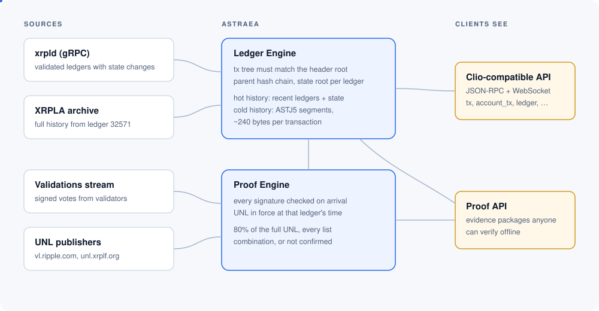

# Architecture

Astraea has two parts, and both follow one rule: store and serve only what has been checked.

The Ledger Engine decides what the ledgers contain. The Proof Engine decides whether the network agreed on them. A ledger shows up in the API only when both are satisfied.

Each part has a page of its own:

- [Loader](loader.md): how ledgers are pulled from a node and checked before anything is written, and how the full history comes from the XRPLA archive.
- [Storage](storage.md): the hot store (state and recent history) and the cold store (ASTJ segments and their indexes).
- [Proof Engine](proof.md): UNL lists, validations, quorum, and the evidence packages built from them.
- [RPC subsystem](rpc.md) and [Web server subsystem](web-server.md): how requests reach the data.
