# Proof Engine

The Proof Engine answers one question: did the network validate this ledger?

- `witness-unl` polls the UNL publishers (by default vl.ripple.com and unl.xrplf.org) and keeps every signed list it receives, byte for byte, along with a log of when each list was seen. Publishers only serve the current list, so this archive is the only way to know later which validators counted at a given time.
- The ingest process subscribes to the validations stream of one or more nodes and checks each signature on arrival. Signing keys are mapped to master keys through manifests from the lists, or through a manifest fetched from a node when a validator rotated keys after the list was published.
- `witness-archiver` stores the raw signed validations in sealed segments. Each closed segment gets a seal that includes the previous seal's hash, so dropping or swapping a segment in the middle is detectable.

The quorum rule is the same everywhere in the codebase, from the loader to the offline verifier: at least 80% of the *full* UNL must have sent full validations for the ledger, the Negative UNL is not subtracted, and if more than one list could have been in force at the ledger's time, quorum has to hold for every combination. A source can delay or hide validations, and then a ledger stays unconfirmed. It can't forge them.

Confirming ledger `N` confirms every loaded ledger before it, because the loader already checked the parent-hash chain.

## Evidence packages

`proof_ledger`, `proof_tx` and `proof_entry` assemble a package from the pieces above:

1. Validations that put an *anchor* ledger over quorum, with the UNL lists and manifests needed to check who was allowed to vote.
2. The chain of headers from the target ledger to the anchor (at most 512). An older target is reached through a skip list instead: the latest state holds the hash of every 256th ledger since the start of history, so the package proves that list in the state of a recent anchored ledger and adds at most 256 headers from the target up to the ledger in the list.
3. For a transaction, the path of sibling hashes from its leaf to the transaction root. For a state object, the path in the state tree, which can also prove that an object does *not* exist.

`witness-verify evidence` checks a package with no network access and no trust in Astraea. The format is specified in [evidence-format.md](evidence-format.md).
